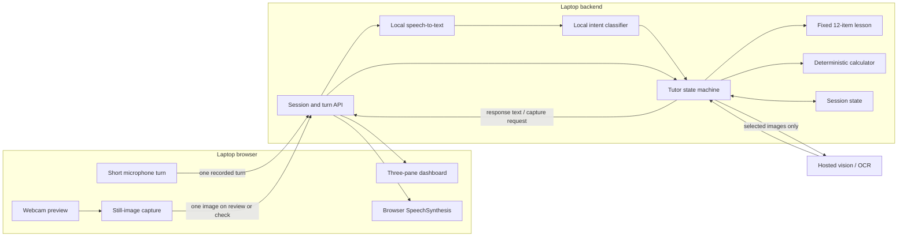
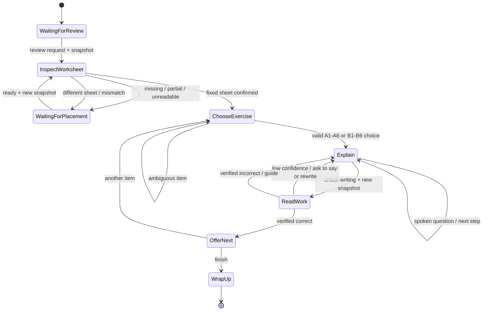

# Architecture: Snapshot-Based Worksheet Review

This is the architecture for the [five-minute PRD](01-PRD-ai-math-tutor.md).
The snapshot API and tutor backend are implemented. The remaining demo work is
the laptop dashboard and local webcam UI (Task 32); there is no iPhone, LiveKit,
or room transport in the active design.

## System boundary

The laptop keeps its webcam preview active locally for framing. It uploads no
video track and sends no frame during ordinary speech. The microphone produces
short speech turns for transcription. The turn and snapshot endpoints are
implemented in `server/contract.py` and `server/session_api.py`.

## Session protocol

1. **Start:** the laptop browser creates a session and obtains webcam and
   microphone permission. The adult positions the external webcam; the student
   has one Start button.
2. **Review intent:** speech-to-text produces "review my worksheet." The
   controller replies with a capture request. The laptop takes a still image
   from the local webcam preview and uploads it with the session id.
3. **Placement gate:** vision classifies `missing`, `partial`, `unreadable`,
   `different_sheet`, or `ready`. For a non-ready result, the tutor asks for
   a concrete adjustment and waits for "Ready" before another capture.
4. **Sheet summary:** for a ready image, vision extracts the printed items and
   operation types. The controller matches all 12 ids and expressions against
   the versioned lesson. The spoken summary is short: A contains addition and
   subtraction; B contains multiplication and division.
5. **Choice:** speech maps an unambiguous phrase to one fixed exercise id.
   A bare item number needs a section. The controller reads the problem from
   the lesson and asks a first guiding question.
6. **Conversation:** each short audio turn is transcribed and classified.
   The controller decides the next step, chooses approved wording or bounded
   phrasing, and returns text to the laptop for speech. No snapshot occurs.
7. **Written-work check:** a request to check writing triggers a new image.
   Vision isolates the selected answer area, returns the read and uncertainty,
   and the controller either asks for clarification or verifies with the
   calculator. It never checks a different item's handwriting by accident.
8. **Finish:** the tutor offers another exercise or wraps up. The demo ends
   after one complete example.

## API messages

These are implemented in `server/contract.py` and `server/session_api.py`.

| Request | Minimum data | Response |
| --- | --- | --- |
| Create session | None | Session id and initial prompt |
| Submit speech turn | Session id, short audio recording | Transcript, tutor text, optional `capture` directive |
| Submit worksheet image | Session id, JPEG, purpose `review` | Placement result, summary or retake prompt |
| Submit work image | Session id, JPEG, purpose `check`, selected exercise id | Read, uncertainty, checked feedback or clarification |
| End session | Session id | Confirmation and session cleanup |

The laptop client never supplies the expected answer. The server owns exercise ids,
lesson state, answer checks, and allowed transitions. Image requests should be
bounded in size and tied to a live session.

## State machine

## Vision and arithmetic contracts

### Worksheet image

Return structured visibility and a list of detected items with section, item
number, expression, and location if available. Match the detected expressions
to the fixed `agent/lessons/grade3_demo.yaml` records. If an item is unclear,
the tutor may summarize only what was verified and request a clearer image
before starting. The known sheet is the source of truth for lesson content;
the image confirms that the expected paper is present.

### Written work

Use the selected item id and its expected location to focus OCR. Return the
literal read, normalized candidate, visibility, and an uncertainty signal.
Uncertainty includes a missing answer, multiple plausible digits, a crop that
cannot be tied to the selected item, or disagreement between OCR passes.
Before any "wrong" feedback, require a sufficiently clear read and calculator
verification. If uncertain, ask the student to confirm orally or rewrite and
recapture. A spoken answer can be checked separately, but must be described as
spoken rather than observed writing.

### Calculator and wording

The calculator validates fixed expressions, final answers, and any intermediate
arithmetic stated aloud. The controller chooses the exercise and step. A local
language model may classify intent or phrase an approved step, but it cannot
invent a new problem or override the calculator. The tutor explains one step,
then waits.

## Speech path

The laptop records a short utterance after Start and uploads it over HTTPS.
Local speech-to-text converts it to text. A small intent set covers
`REVIEW`, `READY`, `CHOOSE`, `ASK_STEP`, `REPEAT`, `CHECK_WRITING`,
`CHECK_SPOKEN_ANSWER`, `NEXT`, and `DONE`, with a deterministic fast path for
clear commands. The laptop speaks the returned text through SpeechSynthesis.
If the student interrupts, it cancels current speech and captures the next
turn; test interruption on the demo laptop. Poor transcription prompts a
clarification rather than advancing state.

## Data handling and failure recovery

- Keep the selected exercise, current step, attempts, and recent turns for the
  active session. A short reconnect can resume by session id.
- Process image and audio uploads transiently. Do not retain raw media by
  default. Keep only the session data needed for the demo and clean it up at
  session end or timeout.
- Use HTTPS; keep hosted-vision credentials on the backend. The selected
  worksheet contains fields for a name and signature, so use an unfilled copy.
- On vision failure, ask for a retry or offer a spoken-only answer check; do
  not claim that writing was read. On STT failure, ask the student to repeat.
- Report stage timings separately for speech transcription, vision, intent,
  and speech start. Set a realistic snapshot-response target after rehearsals.

## Current implementation (2026-11-12)

The LiveKit worker, token endpoint, room client, and `infra/` stack were
removed in Task 26. The active runtime is the FastAPI snapshot API
(`server/session_api.py`), the provider-neutral controller
(`agent/controller.py`), and the browser client in `web/`.

The remaining demo work is Task 32: move the client to the laptop, add the
three-pane dashboard, and use the laptop's local webcam and microphone. There
is no phone or room transport in the architecture. Task 27 rehearses the
result on the laptop with the external webcam.
