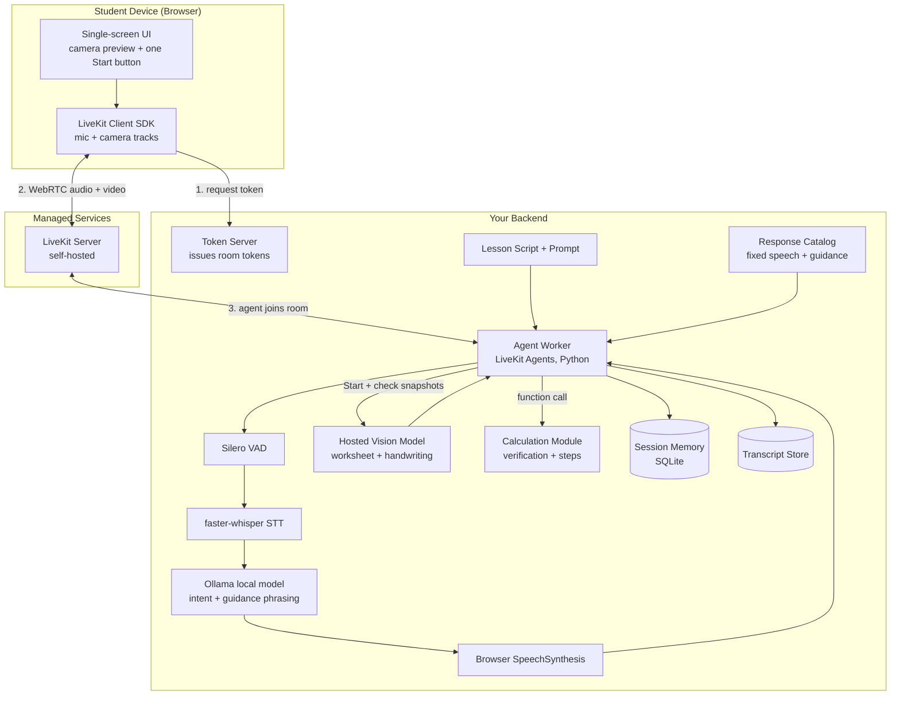
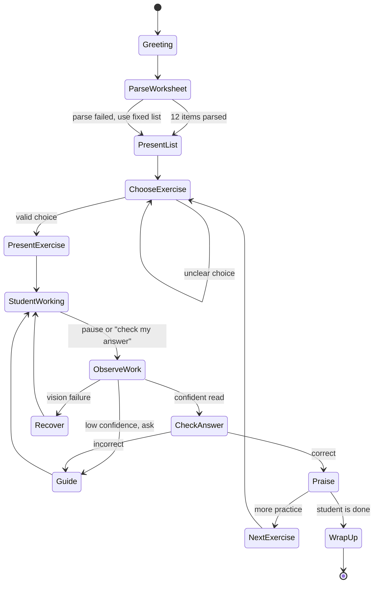
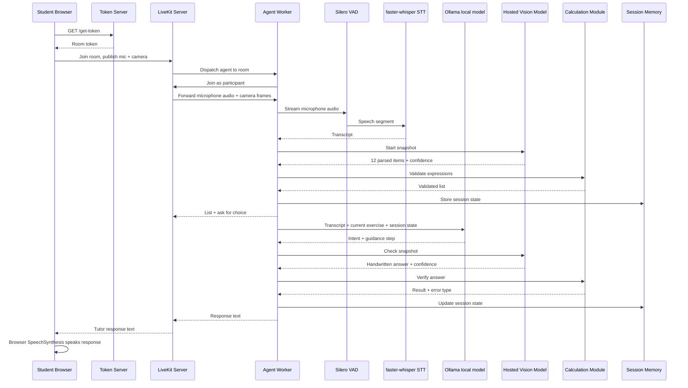

# End-to-End Architecture: Real-Time AI Math Tutor (MVP)

| Field | Value |
| --- | --- |
| Companion doc | `01-PRD-ai-math-tutor.md` |
| Scope | MVP: LiveKit audio/video tracks + sampled worksheet frames + cascaded voice tutoring, English only |
| Note | Code snippets are **illustrative**. Verify current self-hosted LiveKit, Ollama, faster-whisper, and Silero VAD versions before building. |

---

## Demo Scope Update (2026-11-07)

The current five-minute demo changes the MVP architecture in these ways:

- **Worksheet parse at Start:** one snapshot is sent to a vision model to read
  the 12 printed items; expressions are validated by the calculation module.
- **Exercise choice:** the agent asks which exercise to start with and maps the
  spoken choice to an exercise id. Worksheet order is not used.
- **Handwriting vision:** a fresh snapshot is read on "check my answer" or on a
  pause. Low-confidence reads ask for clarification and never correct.
- **Hosted vision by default:** audio, STT, and intent stay local. Local vision
  is the fallback and requires staged handwriting conditions.
- **No hint ladder:** natural guidance is anchored to calculation-module steps.
- **Session memory:** the chosen exercise, step, attempts, last answer, and
  recent turns are persisted in SQLite and injected each turn.
- **Latency target:** about 2.5 s per turn, not 1.5 s.
- **One sheet only:** the two-paper, 10-15 exercise scope is deferred.

The rest of this document remains the long-term architecture context.

---

## 1. Architecture at a Glance



### One-sentence summary
The student's browser publishes microphone and camera tracks to a self-hosted **LiveKit room**. A Python agent worker receives audio and video, uses **Silero VAD** and local **faster-whisper** for speech recognition, sends text and event-driven snapshots to a **hosted vision model** and a local **Ollama** model, verifies math with the deterministic calculator, and sends response text back to the browser for speech through the browser's **SpeechSynthesis** API.

## 2. Technology Stack: What, Why, Alternatives

| Layer | Choice | Why we chose it | Alternatives considered |
| --- | --- | --- | --- |
| Real-time transport | **LiveKit** (WebRTC) | Purpose-built for low-latency audio/video; handles rooms, reconnects, and network adaptation; open source with managed cloud; first-class **Agents framework** for AI participants | Daily, Twilio Video, raw WebRTC (more work), WebSocket streaming (higher latency, no jitter handling) |
| Agent framework | **LiveKit Agents (Python)** | Agent joins the room as a participant and handles audio/video tracks, publishing, and room lifecycle | Custom WebRTC bot, Pipecat, hand-rolled server |
| Voice activity detection | **Silero VAD** | Detects when the student starts and stops speaking before STT | LiveKit VAD, WebRTC VAD |
| Speech-to-text | **faster-whisper** | Local speech recognition with no hosted API key | Vosk, Whisper.cpp |
| Reasoning model | **Ollama local model** | Runs reasoning locally through an HTTP API with no external provider dependency | llama.cpp server, vLLM |
| Text-to-speech | **Browser SpeechSynthesis** | Speaks the fixed approved response without another provider account or API key | Hosted TTS after the demo |
| Math verification | **Custom calculator tool** (function calling) | Deterministic; removes arithmetic hallucination; cheap and fast; can verify both worksheet addition and missing-number-to-100 answers | Letting the LLM calculate (unreliable), external math APIs (unnecessary for the MVP) |
| Worksheet vision | **Hosted vision model on event-driven frames** | Reads the printed items and handwriting with better accuracy than a 3B local model | Local vision model with staged handwriting |
| Lesson content | **One fixed sheet with 12 exercises + deterministic response catalog** | Small enough for the demo while covering the actual worksheet flow | RAG pipeline or dynamic generation (post-demo) |
| Frontend | **Plain web app (React or vanilla JS) with LiveKit JS SDK** | No install; works on phones and tablets; fast iteration | Native mobile app (later), Flutter |
| Token server | **Small API (FastAPI or Node)** | Required to mint LiveKit access tokens securely | LiveKit Cloud sandbox token endpoint (testing only) |
| Storage | **SQLite or Postgres (or even files)** | Transcripts only; trivial volume | Managed DB later |
| Hosting | **One local machine** for LiveKit, agent, token server, Ollama, and faster-whisper | No cloud accounts or external provider APIs for the demo | Local Docker Compose or separate processes |

### Why the cascaded pipeline

| Aspect | Cascaded pipeline (chosen) |
| --- | --- |
| Control | Each VAD, STT, LLM, vision, and TTS stage can be tuned or replaced |
| Voice | Browser SpeechSynthesis uses one selected system voice for the demo |
| Debugging | Each transcript, frame, prompt, and audio response can be logged separately |
| Tradeoff | More components and potentially more latency than a native realtime model |

Decision: use a fully local cascaded pipeline for privacy, predictable costs, and demo-day independence. Keep the audio path asynchronous and measure each stage separately.

## 3. Component Design

### 3.1 Frontend (student device)

**Responsibilities**
- Request camera and microphone permission
- Show live camera preview (rear camera preferred on phones)
- Fetch a LiveKit token from `GET /get-token`, connect to the room, and publish mic and camera tracks
- Show one Start button; Start authorizes capture and begins the room session
- Play the tutor's audio track
- Show minimal status (connecting, listening, tutor speaking)
- Keep interaction voice-first after Start; do not show pause, answer, hint, or End buttons during tutoring

**Key implementation points**
- Use `getUserMedia` constraints: `facingMode: "environment"`, a worksheet-readable resolution, and a low frame rate appropriate for sampled vision.
- Publish the camera track to self-hosted LiveKit and sample frames through `rtc.VideoStream`; do not forward every frame to Ollama.
- Enable echo cancellation, noise suppression, and auto gain on the mic (default in browsers; confirm enabled).
- Keep the screen awake while in session (Wake Lock API).
- Handle autoplay restrictions: the Start press authorizes audio playback; no further student taps are needed.
- Optional framing guide: a semi-transparent rectangle overlay on the preview.
- Handle reconnection events from the SDK and show a simple "reconnecting" icon.

**Suggested structure**
```
web/
  index.html
  src/
    main.ts          # connect flow
    room.ts          # LiveKit room, tracks, events
    ui.ts            # local preview, one Start button, status icon
    snapshots.ts     # event-triggered image capture and upload
    styles.css
```

### 3.2 Token Server

**Responsibility:** create short-lived LiveKit access tokens so the client can join a room without exposing API secrets.

**Flow**
1. Client calls `GET /get-token` (optionally with a session id).
2. Server creates a unique room name and a token with publish/subscribe grants, short TTL.
3. Server may also dispatch the agent to that room (explicit dispatch) or rely on automatic dispatch.

**Why it matters:** never place the LiveKit API secret in frontend code.

### 3.3 LiveKit Server

- Routes microphone and camera tracks between the student and the agent.
- Handles network adaptation, jitter buffering, and reconnects.
- Use **LiveKit Cloud** for MVP (fastest), self-host later if cost or data-residency requires.
- Keep LiveKit, Ollama, faster-whisper, and the agent on the same local machine or LAN for the demo.

### 3.4 Agent Worker (the tutor's "brain host")

**Responsibilities**
- Join the room when a student connects
- Subscribe to student audio
- Subscribe to the student's audio and camera tracks
- Run Silero VAD and forward speech segments to faster-whisper
- Sample camera frames with `rtc.VideoStream` at Start and on check or pause
- Send transcript text to Ollama and snapshots to the hosted vision model
- Register the calculation module and enforce calculator-anchored numbers
- Send response text to the browser
- Browser speaks the response with SpeechSynthesis; no TTS provider is required
- Track lesson state (chosen exercise, current step, attempts)
- Allow only the fixed demo exercise ids; reject unknown or generated exercise ids
- Classify student input into a small intent set and extract candidate answers
- Select fixed speech from the response catalog and allow natural guidance only within verified calculation steps
- Write transcripts and tool logs
- Handle session end and cleanup

**Illustrative skeleton (Python, LiveKit Agents; verify against current API)**
```python
from livekit import agents, rtc

OLLAMA_BASE_URL = "http://localhost:11434"
SYSTEM_PROMPT = open("prompts/tutor.md").read()

async def entrypoint(ctx: agents.JobContext):
    await ctx.connect()
  audio_track = await subscribe_to_audio(ctx.room)
  video_track = await subscribe_to_video(ctx.room)
  speech_segments = silero_vad(audio_track)
  transcript = await transcribe_local(speech_segments, model="small.en")
  frame_stream = rtc.VideoStream(video_track)
  intent = await ollama_classify(
    base_url=OLLAMA_BASE_URL,
    transcript=transcript,
    frame=sample_frame(frame_stream),
    instructions=SYSTEM_PROMPT,
  )
  response_text = select_approved_response(intent)
  await send_response_text_to_browser(ctx.room, response_text)

if __name__ == "__main__":
    agents.cli.run_app(agents.WorkerOptions(entrypoint_fnc=entrypoint))
```

### 3.5 Speech, Vision, and Reasoning Services

The agent uses separate services for speech detection, transcription, reasoning, and speech synthesis.

**Configuration points**
- **Silero VAD:** tune silence thresholds for children and short worksheet answers.
- **STT:** use local faster-whisper with the `small.en` model; log transcript text and processing time.
- **Reasoning:** use a local Ollama model for intent classification and guidance phrasing.
- **Vision frames:** sample `rtc.VideoStream` at Start and after the student says "I'm done" or "check my answer"; send the frame to the hosted vision model.
- **TTS:** use browser `SpeechSynthesis` and keep one system voice fixed for the demo.
- **Structured output:** require an intent and extracted answer, never free-form teaching text.

**Vision policy:** the camera track is available in the agent, but frames are sampled only at Start and at check or pause events. The default is a hosted vision model; a local vision model is the fallback and requires staged handwriting conditions. Check the provider's data-use terms for children's data.

### 3.6 Calculator Moderator (deterministic tool)

**Purpose:** guarantee arithmetic correctness and produce calculator-anchored guidance.

**Design**
- Input: fixed worksheet calculation (for example `4 + 5 + 6` or `100 - 30`), student's answer, optionally the student's working.
- Parse safely (never use `eval` on raw text; use a small expression parser or `ast` with an allowed-operators whitelist).
- Output example:
```json
{
  "correct": false,
  "expected": 15,
  "student_answer": 14,
  "error_type": "addition_error",
  "focus": "add 4 and 5 first, then add 6"
}
```
- Worksheet error classification: missed number, addition error, subtraction-to-100 error, wrong operation, digit reversal, and unclear handwriting.
- Unit-test heavily; this component must be 100% reliable.

**Prompt rule:** the model must call this tool before confirming or correcting any answer, and must not state arithmetic results that did not come from the tool. The response catalog supplies fixed wording; natural guidance must stay within the tool's verified numbers and steps.

### 3.7 Lesson Script

**Format:** a structured file (YAML or JSON) loaded into the prompt or retrieved by the agent per exercise.

```yaml
lesson: "Worksheet demo: one sheet, 12 exercises"
exercises:
  - id: A1
    section: "A"
    item: 1
    problem: "4 + 5 + 6"
    answer: 15
    verification_expression: "4 + 5 + 6"
    steps:
      - "Add 4 and 5"
      - "Add 6 to the result"
      - "Write the answer"
    praise: "Great adding!"
  - id: B4
    section: "B"
    item: 4
    problem: "20 / 4"
    answer: 5
    verification_expression: "20 / 4"
    steps:
      - "Share 20 into 4 equal groups"
      - "Count the items in one group"
      - "Write the answer"
    praise: "Great dividing!"
```

For the demo, keep one fixed worksheet in versioned lesson data, containing 12 exercises. The agent owns the chosen exercise, current step, attempts, and session state; the local Ollama model classifies speech and phrases guidance, and the hosted vision model reads snapshots. The calculation module supplies the verified numbers and teachable steps. Fixed parts of the speech are selected by key; natural guidance is allowed within the verified steps.

### 3.8 Response Catalog And Guidance

The response catalog contains the fixed parts of the student-facing speech. Each response has a stable key and one approved English script. Natural guidance is generated within the steps and numbers supplied by the calculation module.

```yaml
responses:
  greeting:
    text: "Hi! I can see your worksheet. Which exercise would you like to start with?"
  worksheet_list:
    text: "I see 12 exercises: six adding and subtracting, and six multiplying and dividing."
  A1.present:
    text: "Let's solve 4 plus 5 plus 6."
  A1.guide_step_1:
    text: "Add 4 and 5 first. What do you get?"
  A1.correct:
    text: "Great adding. 4 plus 5 plus 6 is 15."
  A1.incorrect:
    text: "Let's check that step together."
  repeat:
    text: "I'll say it again slowly."
```

The model may return structured data such as `{ "intent": "CHECK_ANSWER" }` or a guidance step reference. Fixed parts of the speech are selected from the catalog by key. Natural guidance is allowed only within the steps and verified numbers supplied by the calculation module.

### 3.9 Lesson State Machine (in the agent)



The state machine keeps the tutor on-script. The model handles speech classification, guidance phrasing, and visual perception; the code owns progression, the current step, calculator results, fixed response selection, and session memory.

### 3.10 Logging and Storage

- Save per-session: session id, timestamps, transcript turns (speaker, text), tool calls, errors.
- Do **not** store raw audio or video by default.
- Keep a simple table: `sessions`, `turns`, `tool_calls`.
- Add structured application logs and basic metrics (latency, reconnects) for debugging.

## 4. System Prompt Design

**Structure**
1. **Role and persona:** friendly English-speaking math helper for a Grade 3 student.
2. **Classification rules:** return structured intents and extracted values; guidance phrasing is allowed only within verified steps.
3. **Style rules:** short sentences, one step at a time, slow pace, warm tone.
4. **Pedagogy rules:** one step at a time, never give the answer first, praise effort.
5. **Perception rules:** if handwriting is unclear, ask; never mark wrong on an uncertain read; if paper is not visible, ask to adjust the camera.
6. **Tool rules:** always call `check_math` before confirming or correcting; never state arithmetic results from memory.
7. **Safety rules:** use English only; stay on Grade 3 math; ask no personal questions; redirect off-topic talk; stay age-appropriate.
8. **Response rule:** the application selects fixed speech from the response catalog; natural guidance is limited to verified steps.
9. **Turn-taking rules:** wait after asking a question; check in after silence; ignore speech not directed at you.
10. **Current exercise context:** injected per step.

Keep it concise; very long prompts increase latency and dilute rules. Test with adversarial child-like inputs ("just tell me", "you're boring", random noises).

## 5. End-to-End Sequence



## 6. Latency Budget (target under about 2.5 s)

| Step | Approx. target |
| --- | --- |
| Student speech end detection (VAD) | 200-400 ms |
| Network: device to LiveKit to agent | 50-150 ms |
| Agent to local STT and Ollama | 300-900 ms |
| Snapshot to vision result | 500-1500 ms |
| Browser speech start | 50-200 ms |
| Audio return to student | 50-150 ms |
| **Total** | roughly 1.5-2.5 s |

**Ways to reduce latency**
- Keep agent, LiveKit, faster-whisper, and Ollama on the same machine or LAN.
- Keep prompts short; avoid slow tool calls (calculator is local and instant).
- Tune VAD end-of-speech threshold.
- Send response text to the browser as soon as the response is selected.
- Avoid unnecessary processing in the audio path.
- Measure end-to-end with timestamps on every turn.

## 7. Vision Pipeline Details

| Concern | Approach |
| --- | --- |
| Camera angle and distance vary | Local preview, framing guide, plus voice-guided adjustment |
| Pencil is faint | Ask for good lighting; use higher resolution; consider on-demand snapshot |
| Token and frame-rate limits | Sample `rtc.VideoStream` only on Start and after "I'm done"; do not process every frame locally |
| Handwriting ambiguity (6/9, 2/5, 1/7) | Confidence-aware prompt: ask the child to confirm |
| Shadows / glare | Prompt tutor to suggest moving the lamp or tilting the device |
| Fallback | Add dedicated OCR or a vision-capable model/on-device preprocessing (crop, contrast boost, deskew) if sampled frame reading is insufficient |

**Optional preprocessing (later):** auto-crop to the paper region, increase contrast, deskew, then send the cleaned frame.

## 8. Security and Privacy Architecture

- LiveKit signing credentials stay on the backend; no hosted provider API keys are required.
- Short-lived room tokens, unique room per session, no reuse.
- HTTPS everywhere; WebRTC is encrypted in transit.
- Transcripts stored with session id only; no names or contact details.
- Retention policy and deletion job for transcripts.
- Minimize third-party data: send only what the model needs.
- Rate-limit the token endpoint; add basic abuse protection.
- Consent screen or guardian acknowledgment before first use (design outside the child-facing screen).
- Review the licenses and redistribution terms for the selected local model weights before any public pilot.

## 9. Deployment

| Component | Where | Notes |
| --- | --- | --- |
| Frontend | Static hosting (Vercel, Netlify, Cloudflare Pages, S3) | HTTPS required for camera/mic |
| Token server | Small container or serverless function | Stateless |
| Agent worker | Container on a VM or container service (Fly.io, Render, Railway, AWS, GCP) | Long-running; scale by worker count; one worker handles several concurrent sessions depending on resources |
| LiveKit | Self-hosted LiveKit | Runs locally or on a private demo server |
| Database | SQLite for dev, managed Postgres for pilot | Low volume |

**Configuration (env vars):** `LIVEKIT_URL`, `LIVEKIT_API_KEY`, `LIVEKIT_API_SECRET`, `OLLAMA_BASE_URL`, `OLLAMA_MODEL`, `WHISPER_MODEL`, `LOG_LEVEL`, `DB_URL`.

**Scaling notes:** local CPU/GPU capacity bounds concurrency. For the demo, support one active student session.

## 10. Project Structure

```
ai-math-tutor/
  web/                    # frontend
  server/
    token_server.py       # token endpoint
  agent/
    main.py               # agent entrypoint
    tutor.py              # Agent class, tools
    calculator.py         # deterministic checker + error classifier
    lesson.py             # lesson loader + state machine
    responses.py           # response catalog and selection
    snapshots.py          # sampled rtc.VideoStream frame routing
    audio.py              # Silero VAD and STT pipeline
    llm.py                # Ollama client and structured output
    prompts/
      tutor.md            # system prompt
    lessons/
      grade3_demo.yaml
  tests/
    test_calculator.py
    test_lesson_flow.py
  .env.example
  README.md
```

## 11. Step-by-Step Implementation Plan

### Step 1: Voice-only demo (target: days)
1. Start a self-hosted LiveKit server and generate local room credentials.
2. Build the `GET /get-token` endpoint.
3. Build a minimal web page that joins the room with mic and camera tracks.
4. Connect Silero VAD, faster-whisper, and Ollama; use browser SpeechSynthesis for tutor audio.
5. Verify transcription, structured intents, tutor audio, and stage latency.

**Exit:** child-friendly voice chat works with under about 1.5 s latency.

### Step 2: Add camera and live preview
1. Show the local camera preview with one Start button.
2. Subscribe to the camera with `rtc.VideoStream` and sample worksheet and answer frames.
3. Test the tutor describing the paper and reading printed and handwritten numbers from sampled frames.
4. Add the framing guide and the "check camera" voice behavior.
5. Test varied angles, lighting, and pencil types; tune snapshot timing and image quality.

**Exit:** tutor reliably reads digits from realistic setups.

### Step 3: Calculator tool and lesson flow
1. Implement and unit-test the calculator and error classifier.
2. Register it as a tool; enforce the "always verify" prompt rule.
3. Add the Start snapshot, worksheet parsing, and the 12 fixed exercise records with response catalog entries.
4. Implement the lesson state machine, intent mapping, student choice, and natural guidance.
5. Add the deterministic response catalog and transcript logging.

**Exit:** the 12 fixed exercises pass scripted scenarios, including "just tell me the answer", wrong answers, unclear handwriting, and silence.

### Step 4: Real-child testing and tuning
1. Run sessions with real Grade 3 children and a supervising adult.
2. Tune Silero VAD sensitivity, STT accuracy, browser voice, pacing, and prompt wording.
3. Fix top failure modes; add a dedicated OCR path only if vision accuracy is insufficient.
4. Strip any remaining UI clutter.

**Exit:** metrics in the PRD collected and acceptable.

## 12. Testing Strategy

| Type | What to test |
| --- | --- |
| Unit | Calculator correctness, error classification, lesson state transitions |
| Scripted conversation | Replay child-like inputs for the 12 exercises: wrong answers, "check my answer", silence, off-topic, and noise; confirm the calculation module supplies every number and fixed response keys are stable |
| Vision | Photo set of real worksheets: varied pencils, lighting, angles, messy digits; measure accuracy |
| Latency | Timestamp VAD, STT, vision, Ollama, TTS, and end-to-end response times on real networks |
| Network | Drop and restore connectivity; confirm reconnect and resume |
| Device | iOS Safari, Android Chrome, low-end phones |
| Safety | Attempt prompt-injection and off-topic or inappropriate requests |
| User testing | Observe real children; note distraction points and confusion |

## 13. Cost Considerations

| Cost driver | Notes |
| --- | --- |
| Local LLM | CPU/GPU memory and inference time |
| Local STT | CPU/GPU memory and transcription time |
| Browser speech | No additional provider cost; depends on the selected browser/system voice |
| Self-hosted LiveKit | Local server resources and bandwidth |
| Agent hosting | Compute for worker processes |
| Storage | Negligible (transcripts only) |

Estimate cost per session early by running a few real sessions and reading the provider usage dashboards. Pricing changes often; check current pricing pages.

## 14. Risks and Fallbacks

| Risk | Fallback |
| --- | --- |
| STT mishears children | Tune faster-whisper model size, confirm unclear transcripts, or provide an adult-controlled recovery action |
| Handwriting reads unreliable | Add preprocessing and dedicated OCR; ask child to say the number |
| Latency too high | Change provider regions, shorten prompt, reduce frame sampling, tune VAD, or stream TTS earlier |
| Model ignores rules | Move more logic into code (state machine decides, calculation module supplies numbers, catalog supplies fixed wording); tighten prompt; reject unrecognized model output |
| Local machine overload | Use a smaller local model, reduce frame sampling, or run one session only |
| Child privacy concerns | Keep stream-only design, no media storage, add consent and deletion |

## 15. Future Extensions (post-MVP)

- Teacher/parent view and progress reports
- Student profiles and adaptive difficulty
- Curriculum ingestion with RAG when content grows
- On-screen visual annotations (e.g. highlight the column to focus on)
- Dedicated handwriting OCR and paper auto-detection
- Other languages (keep prompts and lessons in per-language files if the scope expands)
- Native mobile app and stylus-based on-screen writing
- More subjects and grades
