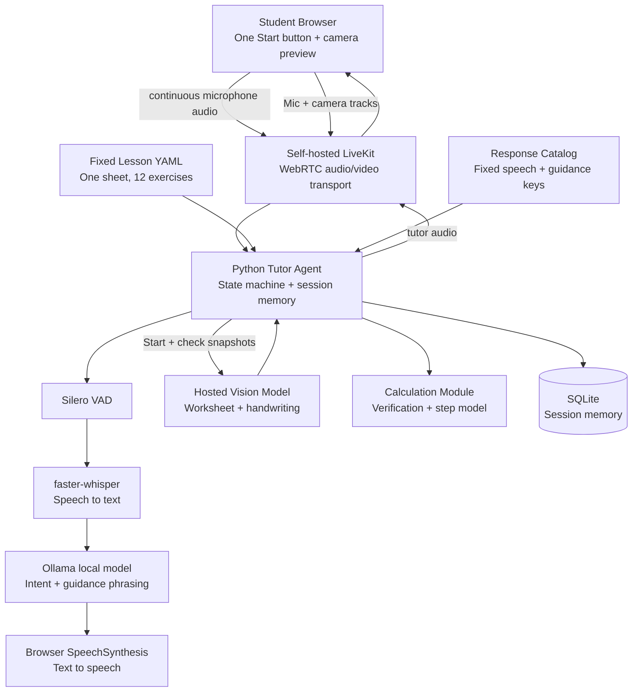

# AI Math Tutor: Tech Stack and Architecture

This document is a short, shareable overview of the technology used by the Grade 3 worksheet tutor demo.

## Demo Scope Update (2026-11-07)

The current five-minute demo uses one worksheet (`docs/image.png`, 12 items) and
is more interactive than the scope below:

- Camera sees the whole sheet and the student's handwriting.
- The agent parses the 12 printed items at Start and asks which one to begin.
- The student chooses by voice; the agent guides step by step.
- There is no hint ladder in this demo.
- Handwriting is read on "check my answer" or on a pause.
- Vision is hosted by default; audio, STT, and intent stay local.
- A deterministic calculation module verifies every number and decomposes the
  exercise into teachable steps.
- Session memory stores the chosen exercise, step, and attempts in SQLite.
- Target latency is about 2.5 s per turn.
- The two-paper, 10-15 exercise scope is deferred.

## Product Scope

- English-only, hands-free math tutor
- Grade 3 worksheet-based demo
- One fixed worksheet (`docs/image.png`) with 12 exercises
- One Start button
- Worksheet snapshot at Start to parse the exercise list
- Event-driven handwriting snapshot on "check my answer" or on a pause
- Student chooses the exercise by voice
- No hint ladder; natural step-by-step guidance
- Fixed parts of the speech plus calculator-anchored guidance
- Warm personality and per-session memory

## Architecture



## Technology Stack

| Layer | Technology | Purpose |
| --- | --- | --- |
| Frontend | TypeScript browser app | Shows the local camera preview and one Start button |
| Camera and microphone | Browser `getUserMedia` | Captures the worksheet and student audio |
| Real-time audio | LiveKit + WebRTC | Sends student audio and returns tutor audio with low latency |
| Tutor agent | Python | Owns lesson state, intent handling, response selection, and session flow |
| Voice activity detection | Silero VAD | Detects speech boundaries before transcription |
| Speech-to-text | faster-whisper | Converts student speech into text locally |
| Reasoning model | Ollama local model | Classifies intent and phrases guidance locally |
| Vision | Hosted vision model (default) | Reads the printed items and handwriting |
| Text-to-speech | Browser SpeechSynthesis | Produces the tutor's spoken response without another API provider |
| Vision frames | LiveKit `rtc.VideoStream` | Samples event-driven frames for the vision model |
| Lesson content | YAML | Stores one sheet and 12 exercise records |
| Response catalog | Python/YAML | Stores fixed speech, guidance keys, praise, and corrections |
| Calculation | Deterministic Python module | Verifies numbers and decomposes the exercise into steps |
| Session memory | SQLite | Stores the chosen exercise, step, attempts, and turns |
| Token server | FastAPI or Node | Creates short-lived LiveKit access tokens securely |
| Storage | SQLite for demo | Stores session memory, transcripts, and calculator/tool logs |

## Interaction Flow

1. An adult grants camera and microphone permission and positions the camera so the whole sheet and the writing area are visible.
2. The student presses the single Start button.
3. The browser publishes microphone and camera tracks to LiveKit.
4. The agent samples one frame and parses the 12 printed items with the hosted vision model.
5. The calculation module validates the parsed expressions.
6. The agent lists the items and asks which exercise to start with.
7. The student chooses by voice; the agent maps the choice to an exercise id.
8. The agent presents the exercise and guides the student step by step.
9. The student writes and says "check my answer" or pauses.
10. The agent samples a fresh frame; the vision model reads the handwriting and returns a confidence score.
11. Low confidence produces a clarification question; high confidence goes to the calculation module.
12. The calculation module verifies the answer and returns the next step or error type.
13. The agent responds with calculator-anchored guidance.
14. Session memory records the exercise, step, attempts, and last answer.
15. Browser `SpeechSynthesis` speaks the response.
16. The agent continues or asks which exercise to do next.

## Important Design Rule

The AI model does not invent numbers. It classifies intent and may phrase
guidance, but every number it speaks comes from the calculation module. Fixed
parts of the speech come from the response catalog, and low-confidence vision
reads ask for clarification instead of correcting.

## Project Files

```text
agent/
  main.py
  tutor.py
  calculator.py
  lesson.py
  responses.py
  snapshots.py
  vision.py
  memory.py
  prompts/tutor.md
  lessons/grade3_demo.yaml
server/token_server.py
web/index.html
web/src/
tests/
```

## Official Documentation

- [LiveKit Agents](https://docs.livekit.io/agents/)
- [LiveKit JavaScript SDK](https://docs.livekit.io/home/quickstarts/javascript/)
- [Ollama](https://ollama.com/)
- [faster-whisper](https://github.com/SYSTRAN/faster-whisper)
- [Browser camera and microphone access](https://developer.mozilla.org/en-US/docs/Web/API/MediaDevices/getUserMedia)
- [FastAPI](https://fastapi.tiangolo.com/)

## Related Project Documents

- [Product Requirements](01-PRD-ai-math-tutor.md)
- [Detailed Architecture](02-Architecture-ai-math-tutor.md)
