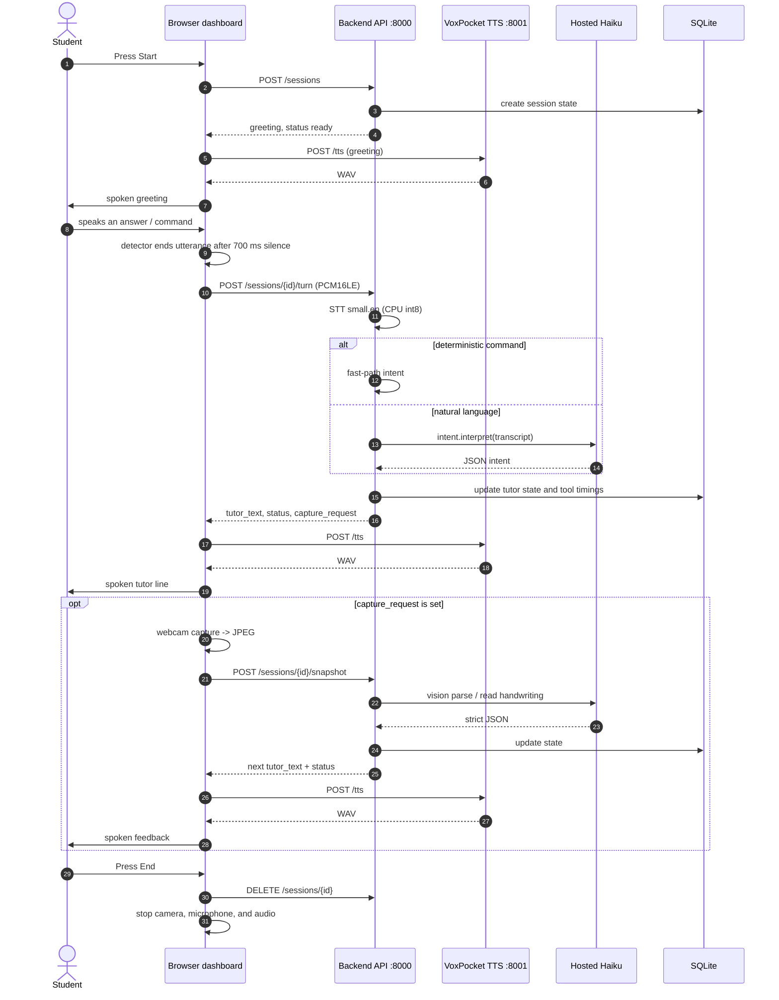

# End-to-End Pipeline (Laptop Demo)

Status: current laptop-only architecture, verified on 2026-11-13.
Scope: one laptop, English Grade 3 math, one fixed worksheet, external USB
webcam. There is **no iPhone, no phone camera, no LiveKit, and no network
camera**.

## 1. Corrected system architecture

The original concept diagram showed a phone camera feeding a laptop backend.
The demo no longer uses a phone. The laptop browser owns the webcam, the
microphone, the dashboard, and the speaker; the backend runs as a local process
on the same machine, and the optional VoxPocket voice service runs beside it.

```text
                              STUDENT
                                 |
                 speaks / shows the worksheet
                                 |
              +------------------v-------------------+
              |            LAPTOP BROWSER            |
              |      https://localhost:5173 (Vite)   |
              |      Start / End session             |
              |                                      |
              |  Microphone --> turn detector         |
              |  Webcam     --> preview + JPEG still  |
              |  Three-pane dashboard                 |
              +----+-----------------------+---------+
                   |                       |
                   | raw PCM16LE           | JPEG still, only when
                   | 16 kHz mono           | the tutor asks for a capture
                   v                       v
              +--------------------------------------+
              |       VITE DEV PROXY (same origin)    |
              |   /sessions  ->  127.0.0.1:8000       |
              |   /tts       ->  127.0.0.1:8001       |
              +----+-----------------------+---------+
                   |                       |
                   v                       |
        +----------------------+           |
        |  BACKEND (FastAPI)   |<----------+
        |  127.0.0.1:8000      |
        |                      |
        |  Session controller  |
        |   |-- STT (CPU)      |
        |   |-- intent         |
        |   |-- vision         |
        |   |-- tutor engine   |
        |   +-- SQLite memory  |
        +----------+-----------+
                   |
                   | tutor_text + status + capture_request
                   v
        +----------------------+        +-----------------------+
        |  BROWSER DASHBOARD   |        |  VOXPOCKET TTS        |
        |  visual response     |<-------|  127.0.0.1:8001       |
        +----------+-----------+  WAV   |  separate process     |
                   |                    +-----------------------+
                   | spoken response
                   v
                STUDENT
```

The VoxPocket process is optional. The demo default speaks with the browser's
`SpeechSynthesis`; only a `VITE_TTS=voxpocket` build calls the service.

### Differences from the old diagram

| Old diagram | Actual demo |
| --- | --- |
| iPhone camera captures images | Laptop webcam (`getUserMedia`) previews and captures one JPEG |
| Phone sends images to the laptop | Browser sends the JPEG over the same-origin HTTPS API |
| "Image processing: OCR + vision" is a local stage | One hosted vision call returns strict JSON (worksheet or handwriting) |
| "Exercise understanding" is open-ended | Fixed 12-item lesson (`docs/image.png`); deterministic placement and answer rules |
| Browser `SpeechSynthesis` speaks | Browser `SpeechSynthesis` is the demo default; the optional VoxPocket service returns a WAV for a `VITE_TTS=voxpocket` build |
| Laptop audio only | Laptop microphone, camera, speaker, and dashboard |

### Services

| Process | Address | Responsibility |
| --- | --- | --- |
| Vite dev server | `https://localhost:5173` | HTTPS page, dashboard, same-origin proxy |
| Backend API | `http://127.0.0.1:8000` | Sessions, STT, intent, vision, tutor state |
| VoxPocket TTS (optional) | `http://127.0.0.1:8001` | Local 44.1 kHz voice; only used by the opt-in build |
| Ollama (optional fallback) | `http://localhost:11434` | Local intent/guidance fallback when configured |

The Vite proxy avoids mixed content: the page is HTTPS, while both local
services are HTTP on loopback.

## 2. Turn flow



The `POST /tts` hops belong to the optional VoxPocket build
(`VITE_TTS=voxpocket`). The default build speaks every `tutor_text` locally with
the browser's `SpeechSynthesis` and makes no `/tts` request, so the greeting,
turn, and snapshot replies reach the student without a TTS service round trip.

### HTTP contract

| Endpoint | Body | Result |
| --- | --- | --- |
| `POST /sessions` | none | `session_id`, first `tutor_text`, `status` |
| `POST /sessions/{id}/turn` | multipart `audio`: raw PCM16LE, mono, 16 kHz, max 15 s | `tutor_text`, `status`, `capture_request`, `exercise_id` |
| `POST /sessions/{id}/snapshot` | multipart `image`: JPEG, max 4 MB; `purpose`: `review` or `check` | next `tutor_text`, `status`, `capture_request`, `exercise_id` |
| `DELETE /sessions/{id}` | none | `{contract_version, session_id, ended}` |

Statuses used by the UI: `ready`, `listening`, `checking_sheet`,
`adjust_sheet`, `reading_work`, `speaking`.

## 3. Measured latency

Measured on 2026-11-13 on the demo laptop (RTX 4050, Python 3.10, Chrome,
hosted Haiku through the OpenCode Go route). The TTS figures below are from the
optional VoxPocket path; the default browser voice makes no TTS request.
"Warm" means the STT model and the VoxPocket model were already loaded; "cold"
means the first request after a process start. Stage durations come from the
backend `tool_calls` table; the browser start figure comes from Playwright smoke
runs.

### Per-phase

| Phase | Warm | Cold / first request | Notes |
| --- | ---: | ---: | --- |
| Browser Start -> dashboard visible | **0.83-0.90 s** | - | 5 smoke runs; includes `POST /sessions`, camera start, recorder start |
| Microphone end-of-speech -> turn sent | **0.70 s** | - | deliberate trailing-silence window; onset window is 150 ms |
| STT `small.en`, CPU int8 | **1.07-1.12 s** | **3.77 s** | 2.7 s clip; cold includes model load |
| Hosted Haiku intent | **1.02-1.19 s** | - | skipped by deterministic fast-path commands |
| Full turn (STT + intent + HTTP) | **2.12-2.29 s** | **4.90 s** | server stages + ~11 ms HTTP overhead |
| Webcam capture + JPEG upload | not isolated | - | ~207 KB JPEG; small next to vision |
| Vision worksheet read | **3.03-3.23 s** | - | 2 API snapshots; 10 post-fix reads were 2.95-4.07 s |
| Full snapshot (upload + vision) | **3.05-3.24 s** | - | one capture request |
| VoxPocket TTS generation | **2.0-2.6 s** typical | **17.3 s** | 1.2-2.7 s observed range; 1.4-2.4 s of audio |
| TTS playback start | immediate after WAV | - | no streaming: generation finishes before playback starts |
| First-ever model download | - | **18 m 26 s** | one-time setup only; already cached |

### End-to-end from "the child stops talking"

Normal turn, no capture:

```text
0.70 s   trailing silence before the turn is sent
2.2 s    STT + hosted intent + HTTP
2.3 s    VoxPocket generation (typical)
------
~5.2 s   until the first tutor audio starts
         (observed phase range: ~4.5-5.7 s)
```

Turn that asks for a worksheet capture (for example, a review request):

```text
0.7 s    trailing silence
2.2 s    turn completes; the first TTS line starts generating
         and the webcam capture / vision call start in parallel
3.2 s    vision completes
2.3 s    summary TTS generation
------
~8.4 s   until the summary audio starts
         (observed phase range: ~7-10 s)
```

The first line ("Let me look at your worksheet.") is spoken while vision is
running. Its audio is roughly 2 s long against a 3.2 s vision call, so the
audible pause before the summary is about **1-1.5 s**, not a full extra 3 s.

### Where the time goes

1. **Vision**, about 3.2 s, only on capture turns.
2. **VoxPocket TTS**, about 2.3 s per line in the optional build, because the
   whole WAV is generated before playback. The default browser voice has no
   service or generation wait; its start follows the browser's own voice engine.
3. **STT + intent**, about 2.2 s combined.
4. **700 ms** detector silence is intentional, not processing delay.

### Cold-start rules

- Start the backend before the rehearsal.
- Only for the opt-in VoxPocket build: start the TTS service and send one short
  line through it so the VoxPocket model loads (**17-20 s**) before the student
  presses Start. A first cold request has been observed at **53.8 s**.
- The first backend turn after a fresh process pays about **2.7 s** extra for
  the STT model. The first worksheet snapshot has no such model load.
- In `voxpocket` mode the 20 s browser TTS watchdog hands a line to the browser
  voice if VoxPocket exceeds the budget, so a forgotten warm-up changes the
  voice mid-demo instead of freezing the UI.

## 4. Failure and fallback behavior

| Failure | Behavior |
| --- | --- |
| Hosted intent unavailable | One local qwen fallback when configured; otherwise a service/retry response |
| Clear command | Deterministic fast path; no model call |
| STT fails | `service_error` style response; the UI stays in `listening` |
| Vision fails or times out | `adjust_sheet` plus `capture_request`; the student retakes the sheet |
| Worksheet is not readable / not the right sheet | Specific placement prompt; no exercise advance |
| VoxPocket is down or slow (opt-in build) | Browser `SpeechSynthesis` speaks the same text; a 20 s watchdog triggers the fallback |
| Camera or microphone denied | Start error identifies permission/hardware and restores Start |
| Browser tab closes | Session is ended with a keepalive request; camera and mic stop on `pagehide` |

## 5. Data and privacy

- Raw audio is request-scoped; the backend does not store it.
- No raw video is stored. One JPEG still is held in page memory for the
  "Last capture" thumbnail and discarded when the session ends.
- The TTS service does not log tutor text, prompts, or keys.
- SQLite stores session state, tutor step, exercise id, placement, and tool
  timings (name, duration, success), not audio or images.
- Transcripts and worksheet images are sent only to the configured hosted
  providers (intent and vision respectively). If `TUTOR_RENDERER=llm` is
  explicitly enabled, the vetted tutor line and the child's answer are also
  sent to the renderer route; the demo uses `template`.

## 6. Known limits

- English only; Grade 3 fixed worksheet with 12 items.
- Vision and intent depend on the hosted provider; latency varies with the
  network and provider load.
- The default browser voice depends on the laptop's installed voices; its
  quality and latency vary by browser and OS.
- VoxPocket is not streaming, so in the opt-in build first-audio latency equals
  full generation.
- Occasional VoxPocket badcase retries can exceed the 20 s watchdog; the
  browser voice covers the line.
- All live proof so far uses a synthetic camera frame (`docs/image.png`) and
  synthetic speech. The real external-webcam rehearsal is Task 27.

## 7. Measurement method

- Stage timings: backend `tool_calls` rows (`stt.transcribe`,
  `intent.interpret`, `vision.parse_worksheet`) for real API requests.
- Request timings: HTTP client wall clock around `/turn` and `/snapshot`.
- Browser start: Playwright smoke with a fake camera and fake microphone.
- TTS: HTTP wall clock around `POST /tts` for the optional VoxPocket build;
  cold measurement was the first request after service start.
- Samples: 5 warm turns across the timing runs, 2 snapshots, 10 post-fix
  direct vision reads, 5 browser starts, 4 warm TTS lines. Ranges are reported
  rather than single medians.
